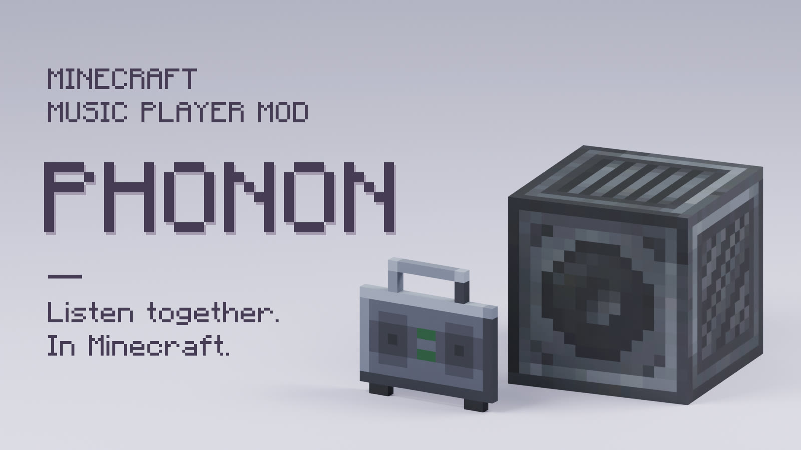
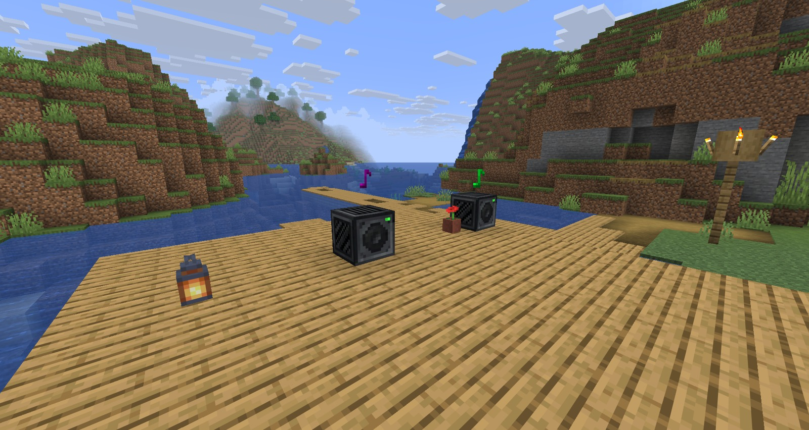
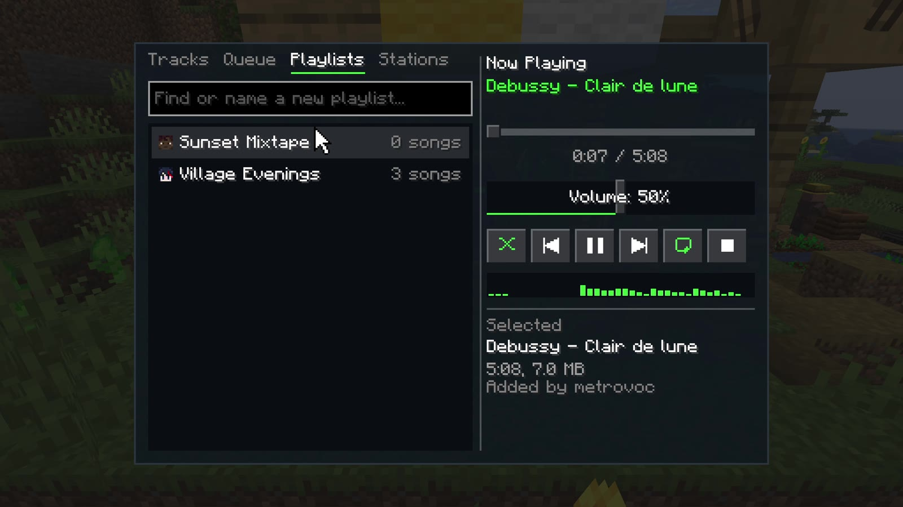

# Phonon



Listen together in Minecraft. Play your music through speakers and boomboxes, and everyone nearby hears the same moment of the same song.



## What you can do

- **Add any song.** Find it by title in the game, paste a link, or drop files into the world.
- **Place a speaker.** The music comes from where it stands. Walk past and it moves, and walls and water muffle it.
- **Carry a boombox.** It keeps playing in your inventory, on your cursor and on the ground.
- **Run a station.** One queue, every speaker tuned to it, every player in step, even across dimensions.
- **Build playlists.** Queue, shuffle and repeat, with playlists saved for the whole server.
- **Wire it up.** Redstone controls a speaker, comparators read its progress, and parrots dance to it.

## Install

Install [NeoForge](https://neoforged.net) and Phonon on both the client and the server. Download from
[Modrinth](https://modrinth.com/mod/phonon) or [GitHub](https://github.com/metrovoc/Phonon/releases), and choose the
file whose name has your exact Minecraft version.

Minecraft 26.x needs Java 25, and 1.21.x needs Java 21.

## Get started

1. Find the Speaker in the creative menu under Functional Blocks or Redstone Blocks, or craft it once you have a jukebox.
2. Right-click it and type a song's title or paste a link into the search box. You can also run `/phonon add <link or title>`.
3. Double-click the song to play it.

Volume follows the game's Jukebox/Note Blocks slider.

To add local files, put them in `phonon_music` inside the world folder and run `/phonon reload`. MP3, WAV, FLAC, M4A,
AAC, Opus, WMA and OGG are accepted, and the originals stay in the folder.

## Audio tools

Adding audio happens on the machine that runs the server, which in singleplayer is your own PC. Direct links to OGG
files need nothing else. Other links and non-OGG files need yt-dlp, FFmpeg and Deno.

If they are missing, Phonon offers to install them in chat the first time they are needed. An operator clicks to
accept, and pinned builds with verified checksums go into `phonon/tools` in the game folder. Tools already on `PATH`
are used when Phonon hasn't installed its own. Server owners can turn this off with `allowToolInstall`.

To install them yourself on Windows, run this, then restart the Minecraft Launcher. winget installs FFmpeg and Deno too.

```powershell
winget install --source winget --id yt-dlp.yt-dlp
```

### When a site blocks the server

Sites often distrust addresses from cloud hosts, and the server does the downloading, so links fail as well as searches.
Run `/phonon tools update` first, since an old yt-dlp fails in similar ways. After that, the server config has
`downloadProxy` and `cookiesFile`. yt-dlp warns that an account used this way can be banned, so use a spare one and keep
the file private.

## The speaker screen



- **Tracks**: the library. Double-click to play, or hover a song for play now, play next and add to a playlist. Typing
  filters the list, and if you may add songs, the green row below finds what you typed on YouTube, SoundCloud or
  Bilibili, or adds a pasted link.
- **Queue**: what's up next. Double-click to jump, or remove a row.
- **Playlists**: saved lists anyone can make, credited to their creator. Open one to add songs by typing, drag to
  reorder, and rename it.
- **Stations**: music one person runs, for everyone who listens in. Typing a new name shares what's playing as a
  station, and typing an existing name tunes to it. Leave brings your own music back where it was.

The screen says who a button affects, and greys out what you can't change.

## Boombox

Craft one from a Speaker, or find it after the music discs in the creative menu. Use it to open its controls, or sneak
and use it to switch it on or off. It tunes to stations like a speaker does. Put away in a chest, or with its holder
offline, its own music waits and carries on from the same point; a station keeps going without it.

## Redstone

A signal turning on acts by side, as seen facing the speaker:

| Side | Action |
|------|--------|
| Left | Previous track |
| Right | Next track |
| Back | Stop |
| Front, top, bottom | Play or pause |

A comparator reads how far through the track the speaker is: 1 at the start up to 15 at the end, and 0 when stopped.
Sculk sensors hear it start and stop, and nearby parrots and allays dance.

## Commands

All commands need operator permission.

| Command | Description |
|---------|-------------|
| `/phonon add [name] <link>` | Download and register audio. Without a name, it uses the video's title |
| `/phonon add <title>` | Add the first YouTube result for the title |
| `/phonon list` | View registered audio |
| `/phonon remove <name>` | Remove audio |
| `/phonon reload` | Reload configuration and import new files from the music folder |
| `/phonon tools` | Show audio tool versions, and which sites last worked or were blocked |
| `/phonon tools install` | Install yt-dlp, FFmpeg and Deno into the game folder |
| `/phonon tools update` | Update Phonon's yt-dlp, installing it first if it's only on the system |
| `/phonon tools help` | What to do when a site blocks the server |

## Server settings

| Setting | What it does |
|---------|--------------|
| `ownerOnlySpeakers` | Limits a speaker to whoever placed it and operators |
| `anyoneCanAddTracks` | Lets every player add songs. Players can delete only what they added |
| `anyoneCanControlStations` | Lets anyone tuned to a station change what it plays. Otherwise only its creator and operators can |
| `audioQuality` | Vorbis quality of newly added audio, from 0 (smallest) to 10 (best) |

## License

[GPL-3.0](LICENSE). Not an official Minecraft product. Not approved by or associated with Mojang or Microsoft.
