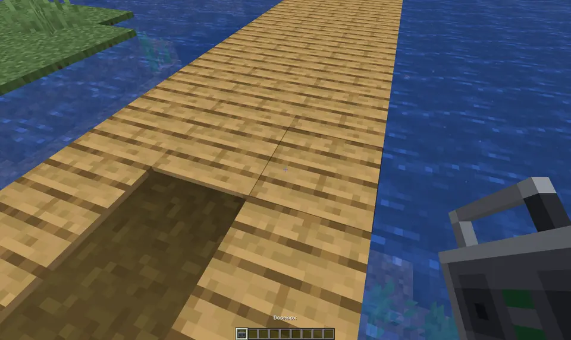

# Phonon

A custom audio system designed to orchestrate an immersive soundscape in your game.



Phonon is currently in beta. The default branch targets Minecraft 26.2, and
every supported Minecraft release receives its own NeoForge artifact. The
Minecraft version in the filename must match the game exactly.

## Features

- **Speaker Blocks** - Place in-world speakers that play custom audio
- **Boombox** - A speaker you carry, that keeps playing in your inventory, on your cursor and on the ground
- **Stations and Playlists** - A queue, shuffle and repeat, and named stations that keep every speaker in step
- **Real-time Sync** - All players hear the same audio at the same time
- **Universal URL Support** - YouTube, Bilibili, or any URL via yt-dlp integration
- **Music Folder** - Drop audio files into the world and they become tracks
- **Spatial Audio** - Sound emanates from speaker locations
- **Streaming Playback** - Playback can begin before a track finishes downloading
- **Bounded Cache** - Downloaded OGG files are cached with configurable LRU-style eviction

## Requirements

Client and server:

- Java and NeoForge versions declared by the selected Minecraft artifact

Adding audio happens on the machine that runs the server, which in singleplayer
is your own PC. Direct links to OGG files need nothing else. Other links and
non-OGG files need yt-dlp, FFmpeg and Deno.

If they are missing, Phonon offers to install them in chat the first time they
are needed. An operator clicks to accept, and pinned builds with verified
checksums go into `phonon/tools` in the game folder. Server owners can turn this
off with `allowToolInstall` in the server config, and tools already on `PATH`
are used when Phonon hasn't installed its own.

To install them yourself on Windows:

```powershell
winget install --source winget --id yt-dlp.yt-dlp
```

winget also installs FFmpeg and Deno. Restart the Minecraft Launcher afterwards.

## Usage

1. Find the Speaker in the creative menu under Functional Blocks or Redstone
   Blocks, or craft it once you have a jukebox
2. Add a song with `/phonon add <link or title>`
3. Right-click the Speaker, select the track and press play

All players near the speaker will hear synchronized playback.

Volume follows the game's Jukebox/Note Blocks slider.

To add local files, put them in `phonon_music` inside the world folder and run
`/phonon reload`. MP3, WAV, FLAC, M4A, AAC, Opus, WMA and OGG are accepted. The
originals stay in the folder.

## Stations and playlists

The Speaker screen has four tabs:

- **Tracks**: the library. Double-click to play, or press **+** on a row to play it
  next. Operators can also delete tracks here, and add new ones with the **+** by the
  search box: paste a link, or type a title to pick from YouTube results with thumbnails.
- **Queue**: what plays next. Double-click to jump, or remove a row.
- **Playlists**: saved lists anyone can make, credited to their creator.
- **Stations**: tune speakers to a shared station to play the same thing in step.

The server config's `ownerOnlySpeakers` limits a speaker to whoever placed it and
operators, and what plays on a station to whoever created it and operators.
`anyoneCanAddTracks` lets every player manage the library.

## Boombox

A speaker you carry: craft one from a Speaker, or find it after the music discs in the
creative menu. Use it to open its controls, or sneak and use it to switch it on or off.
It plays from wherever it is, in your inventory, on your cursor or on the ground, and
tunes to stations like a speaker does. Put away in a chest, or with its holder offline,
its own music waits and carries on from the same point; a station keeps going without it.

## Redstone

A signal turning on acts by side, as seen facing the speaker:

| Side | Action |
|------|--------|
| Left | Previous track |
| Right | Next track |
| Back | Stop |
| Front, top, bottom | Play or pause |

A comparator reads how far through the track the speaker is: 1 at the start up to
15 at the end, and 0 when stopped. Sculk sensors hear it start and stop, and nearby
parrots and allays dance.

## Commands

All commands need operator permission.

| Command | Description |
|---------|-------------|
| `/phonon add [name] <link>` | Download and register audio. Without a name, it uses the video's title |
| `/phonon add <title>` | Add the first YouTube result for the title |
| `/phonon list` | View registered audio |
| `/phonon remove <name>` | Remove audio |
| `/phonon reload` | Reload configuration and import new files from the music folder |
| `/phonon tools` | Show which audio tools were found |
| `/phonon tools install` | Install yt-dlp, FFmpeg and Deno into the game folder |
| `/phonon tools update` | Update the yt-dlp that Phonon installed |

The server config's `audioQuality` sets the Vorbis quality of newly added audio,
from 0 (smallest) to 10 (best).

## Compatibility

Each target is pinned to one Minecraft and NeoForge version. `main` tracks the
newest target (26.2); older targets live on permanent release branches.

| Minecraft | NeoForge | Java | Release branch |
| --- | --- | --- | --- |
| 1.21.1 | 21.1.235 | 21 | `release/minecraft-1.21.1` |
| 1.21.2 | 21.2.1-beta | 21 | `release/minecraft-1.21.2` |
| 1.21.3 | 21.3.96 | 21 | `release/minecraft-1.21.3` |
| 1.21.4 | 21.4.157 | 21 | `release/minecraft-1.21.4` |
| 1.21.5 | 21.5.97 | 21 | `release/minecraft-1.21.5` |
| 1.21.6 | 21.6.20-beta | 21 | `release/minecraft-1.21.6` |
| 1.21.7 | 21.7.25-beta | 21 | `release/minecraft-1.21.7` |
| 1.21.8 | 21.8.53 | 21 | `release/minecraft-1.21.8` |
| 1.21.9 | 21.9.16-beta | 21 | `release/minecraft-1.21.9` |
| 1.21.10 | 21.10.64 | 21 | `release/minecraft-1.21.10` |
| 1.21.11 | 21.11.42 | 21 | `release/minecraft-1.21.11` |
| 26.1 | 26.1.0.19-beta | 25 | `release/minecraft-26.1` |
| 26.1.1 | 26.1.1.15-beta | 25 | `release/minecraft-26.1.1` |
| 26.1.2 | 26.1.2.80 | 25 | `release/minecraft-26.1.2` |
| 26.2 | 26.2.0.15-beta | 25 | `release/minecraft-26.2` |

The beta line currently covers 26.2 and 1.21.1, which pass a scripted checklist
in the real client and on a dedicated server. The other targets remain at
`0.3.0-alpha.3`.

## Releases

Release tags use `v<mod-version>+mc<minecraft-version>`, for example
`v0.3.0-alpha.1+mc26.2`. Untested ports remain alpha, manually smoke-tested
builds may become beta, and only soaked beta builds become stable. See
[RELEASING.md](RELEASING.md) for the branch model, promotion rules, and test
checklist.
